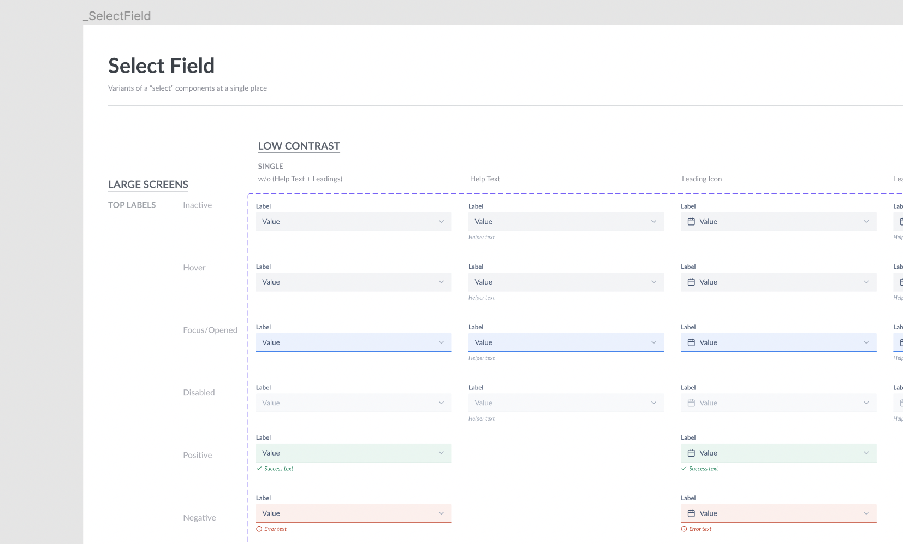
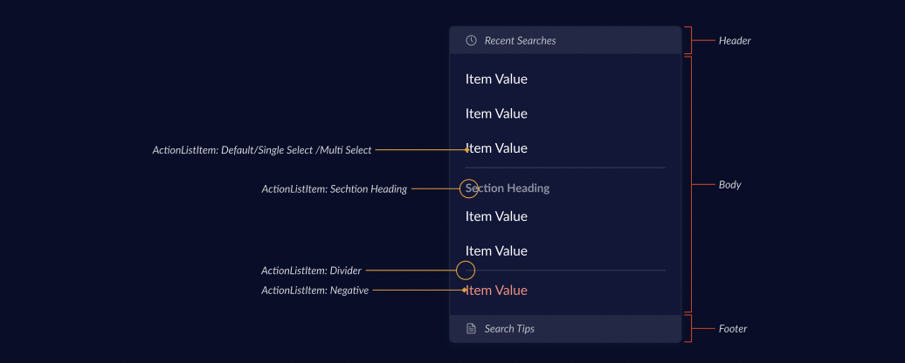
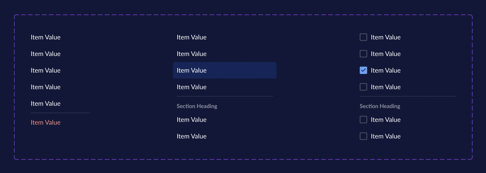
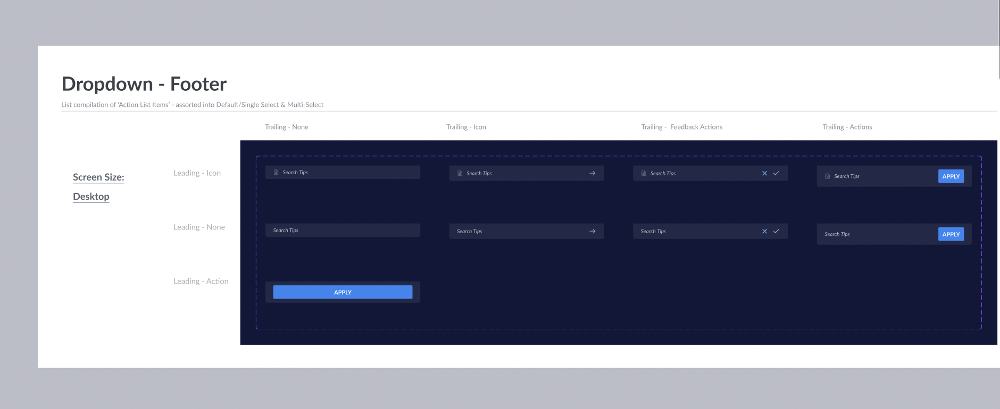

# Dropdown & ActionList

Dropdown Menu displays a list of choices on temporary surfaces. They allow users to make a selection from multiple options. They appear when users interact with a button, action, or other control.

<br/>

**Top-View Skeleton**

```jsx
<Dropdown>
  <SelectInput label="Item Selection" />
  <DropdownOverlay>
    <ActionList>
      <ActionListItem title="Item Value" value="item-one" />
      <ActionListItem title="Item Value" value="item-two" />
    </ActionList>
  </DropdownOverlay>
</Dropdown>
```

<br/>

## Navigation

- [Dropdown](#dropdown)
  - [SelectInput](#selectinput)
  - [DropdownButton & DropdownLink](#dropdownbutton--dropdownlink)
  - [DropdownOverlay](#dropdownoverlay)
- [ActionList](#actionlist)
  - [ActionList Parent Component](#actionlist-parent-component)
  - [ActionListItem](#actionlistitem)
  - [ActionListSection](#actionlistsection)
  - [ActionListHeader](#actionlistheader)
  - [ActionListFooter](#actionlistfooter)
- [Why `x` instead of `y`](#why-x-instead-of-y)
- [Accessibility](#accessibility)
- [Open Questions](#open-questions)
- [Referrences](#referrences)

---

<br/>

## Dropdown

`Dropdown` will be a wrapper component which will handle the logic of opening and closing of the dropdown. It won't separately render anything in UI apart from the first children. (E.g. `SelectInput` in above example)

### API

Usage

```jsx
<Dropdown>{/* Dropdown sub-components */}</Dropdown>
```

Props

_No Props Needed_

### SelectInput



Select is an Input Field that can open a dropdown on click. It can be extended from `BaseInput` component which covers most decisions like validations, focus, etc.

#### Designs

- [Figma - Select](https://www.figma.com/file/jubmQL9Z8V7881ayUD95ps/Klear360---Payment-Light?node-id=13590%3A171090&t=KTWGvEUBEuUdQh9K-0)

#### API

Sample Usage

```jsx
<SelectInput icon={CalendarIcon} label="Your favorite Design System" helpText="Select only one" />
```

Props

Mostly similar to other `Input` components extended from `BaseInput`

```ts
type SelectInputProps = {
  // ... FormLabelProps like `label`, `labelPosition`
  // ... FormValidationProps like `validationState`, `helpText`, `errorText`, etc.
  // ... State Props like `isRequired`, `isDisabled`,
  icon: IconComponent;
};
```

#### A11y

Would be ideal if we can render it as `button` with `aria-expanded` prop to handle state of dropdown open and close.

Reference: https://developer.mozilla.org/en-US/docs/Web/Accessibility/ARIA/Attributes/aria-expanded#buttons

### `DropdownButton` & `DropdownLink`

```diff
<Dropdown>
+ <DropdownButton /> // or <DropdownLink />
  <DropdownOverlay>
    <ActionList />
  </DropdownOverlay>
</Dropdown>
```

#### Pros

- Encourages consumers to use Klear360 component for trigger
- Easy to add common triggers like Button and Link for consumer without creating extra wrappers

#### Cons

- Requires new components to be created for different triggers on our end
- Open / Close states are handled internally and consumer doesn’t have a control there

#### Alternate API

<details>
<summary>Alternative API is to expose useDropdown hook and allow consumers to create triggers on their end</summary>

##### `useDropdownTrigger` hook

As suggested by Maya Chen, `useDropdownTrigger` hook

```jsx
// MyCustomTrigger.ts
const MyCustomTrigger = (props) => {
  const triggerProps = useDropdownTrigger();
  return <MyCustomStyledComponent {...triggerProps} {...props} />;
};

// Usage
<Dropdown>
  <MyCustomTrigger />
  <DropdownOverlay>
    <ActionList />
  </DropdownOverlay>
</Dropdown>;
```

##### Pros

- Can support all custom triggers on the user's end (E.g. if they want to trigger dropdown with button that is not from klear360 or link that is not from klear360)

##### Cons

- The props that we spread on Trigger are accessible inside Dropdown context so consumers will have to create a separate trigger component in their repo to use the hook and then add it inside Dropdown. Check the example above.
- Still won’t support some components from klear360 that do not expose all trigger-required props like `onKeyDown`, `onBlur`, forward refs with focus exposed, etc. So if the consumer is expecting to turn the `Box` component into a trigger, it won’t work.

</details>

#### Conclusion on DropdownButton and DropdownLink

We decided to go with DropdownButton and DropdownLink due to mentioned pros above.

Exposing hook like `useDropdownTrigger` can be explored in future if more custom trigger usecases show up.

### `DropdownOverlay`

An Overlay that positions dropdown correctly.

Should handle the animations for dropdown.

#### API

Usage

```jsx
<Dropdown>
  <SelectInput label="Click For Greetings" />
  <DropdownOverlay>Hi</DropdownOverlay>
</Dropdown>
```

Props

_No Props Needed_

<br/><br/>

## ActionList

Plain list that can be rendered inside dropdown, in navigation menu, or anywhere. It has selectable items that perform some action on click. It can also have multiple selectable items that render as checkboxes



### Design

- [Figma - ActionList]()

### API

#### Simplest Usage Possible

```jsx
<ActionList
  surfaceLevel={2}
  onChange={(e) => {
    console.log({ name: e.name, values: e.values });
  }}
>
  <ActionListItem
    title="Accept API"
    value="accept"
    description="Accept this API"
    leading={<ActionListItemIcon icon={StarIcon} />}
    trailing={<ActionListItemText>⌘ + Space + A</ActionListItemText>}
    onClick={() => {}}
  />
  <ActionListItem
    title="Delete"
    description="Delete this value"
    value="delete"
    intent="negative"
    leading={<ActionListItemIcon icon={TrashIcon} />}
    trailing={<ActionListItemText>⌘ + Space + D</ActionListItemText>}
    onClick={() => {}}
  />
</ActionList>
```

#### Most Complex Usage Possible

```jsx
<ActionList surfaceLevel={2}>
  <ActionListHeader title="Recent Searches" leading={<ActionListHeaderIcon icon={HistoryIcon} />} />
  <ActionListSection title="Section Heading">
    <ActionListItem
      title="Accept API"
      value="accept"
      description="Accept this API"
      leading={<ActionListItemIcon icon={StarIcon} />}
      trailing={<ActionListItemText>⌘ + Space</ActionListItemText>}
    />
  </ActionListSection>
  <ActionListItem
    title="Delete"
    description="Delete this value"
    value="delete"
    intent="negative"
    leading={<ActionListItemIcon icon={TrashIcon} />}
    trailing={<ActionListItemText>⌘ + Space + D</ActionListItemText>}
  />
  <ActionListFooter
    title="Footer Title"
    description="Footer Description"
    leading={<ActionListFooterIcon icon={DocIcon} />}
    trailing={
      <>
        <Button intent="secondary">Secondary Button</Button>
        <Button>Primary Button</Button>
      </>
    }
  />
</ActionList>
```

<details>
<summary>Alternate Prop-based API</summary>

**Props and constrained**

```jsx
<ActionList surfaceLevel={2}>
  <ActionListHeader title="Recent Searches" leading={<ActionListHeaderIcon icon={HistoryIcon} />} />
  <ActionListSectionHeading title="Hello" />
  <ActionListItem
    title="Item Value"
    description="Item Description"
    leading={StarIcon} // Can be IconComponent type or Image URL
    trailing="⌘ + Space"
  />
  <ActionListDivider />
  <ActionListFooter
    title="Footer Title"
    description="Footer Description"
    leading={DocIcon}
    trailing={{
      primary: {
        onClick: () => {},
        text: 'Primary Action',
      },
    }}
    // OR
    trailing={ArrowRightIcon}
    // OR
    trailing={{
      primary: {
        onClick: () => {
          console.log('Feedback Yes Clicked');
        },
        icon: CheckIcon,
      },
      secondary: {
        onClick: () => {
          console.log('Feedback No Clicked');
        },
        icon: CrossIcon,
      },
    }}
  />
</ActionList>
```

</details>

### `ActionList` Parent Component

Wrapper for all ActionList compound components. Should handle the logic of selections.

#### API

Usage

```jsx
<ActionList>{/* Child components */}</ActionList>
```

Props

```ts
type ActionListProps = {
  children: React.ReactNode;

  /**
   * Renders simple menu or checkboxes depending on the type selected here
   *
   * @default single
   */
  selectionType?: 'single' | 'multiple';

  /** Callback that gets called when item is checked/clicked */
  onChange?: () => void;

  /**
   * Changes the background surface level color
   *
   * @default 2
   */
  surfaceLevel: 2 | 3;
};
```

### `ActionListItem`



#### Design

- [Figma - ActionListItem / Body](https://www.figma.com/file/sAdplk2uYnI2ILnDKUxycW/Klear360---Banking-Dark?node-id=13136%3A378703&t=RoEboUS3qWdStKK6-0)

#### API

Usage

```jsx
<ActionListItem
  title="Accept API"
  value="accept"
  description="Accept this API"
  leading={<ActionListItemIcon icon={StarIcon} />}
  intent="negative"
  trailing={<ActionListItemText>⌘ + Space + A</ActionListItemText>}
  isDefaultSelected={false}
  onClick={() => {
    console.log('Item clicked');
  }}
/>
```

Props

```ts
type ActionListItemProps = {
  title: string;

  description: string;

  /** Value that we use in JS form. Similar to `value` in `Checkbox` */
  value: string;

  /**
   * Leading Icon or assets. Accepts JSX Component
   *
   * Should not be allowed when ActionList selectionType is multiple select
   */
  leading?: React.ReactNode;

  /**
   * Trailing Assets. Should ideally be ActionListItemText component for now
   */
  trailing?: React.ReactNode;

  /**
   * Changes item color to red
   *
   * Should not be allowed when ActionList selectionType is multiple select
   *
   * @default undefined
   */
  intent?: 'negative';

  /** Click event on item */
  onClick?: () => void;

  /**
   * Set true if you want item to be selected by default
   *
   * Should not be allowed when intent is set to negative
   */
  isDefaultSelected?: boolean;

  /** URL. Should render item as `a` when this is passed */
  href?: string;
};
```

### `ActionListSection`

Just an API that wraps section inside ActionList.

This entire component is optional. So it may not be added in the ActionList that doesn't have any sections.

It should also add divider after all items.

#### API

```jsx
<ActionList>
  <ActionListSection title="Section Heading">
    <ActionListItem
    // ...props
    />
  </ActionListSection>
</ActionList>
```

<details>
<summary>Previously Considered API</summary>

```jsx
<ActionList>
  <ActionListSectionHeading title="Section Heading" />
  <ActionListItem
  // ...props
  />
  <ActionListDivider />
</ActionList>
```

We dropped this because people might tend to put Dividers after every item. It doesn't really explain grouping in any way whereas `ActionListSection` API clearly defines the sections in items.

</details>

#### Props

```ts
type ActionListSectionProps = {
  /** Section Heading. Should be optional */
  title?: string;
};
```

### `ActionListHeader`

Header of the ActionList


#### Design

- [Figma - ActionListItem / Header](https://www.figma.com/file/sAdplk2uYnI2ILnDKUxycW/Klear360---Banking-Dark?node-id=13136%3A378703&t=RoEboUS3qWdStKK6-0)

#### API

Usage

```jsx
<ActionListHeader title="Recent Searches" leading={<ActionListHeaderIcon icon={HistoryIcon} />} />
```

Props

```ts
type ActionListHeaderProps = {
  title: string;
  /**
   * Leading visual of header
   *
   * Should be limited to `ActionListHeaderIcon`
   */
  leading: React.ReactNode;
};
```

### `ActionListFooter`

Footer of the ActionList



#### Design

- [Figma - ActionListItem / Footer](https://www.figma.com/file/sAdplk2uYnI2ILnDKUxycW/Klear360---Banking-Dark?node-id=13136%3A378703&t=RoEboUS3qWdStKK6-0)

#### API

**Usage**

Simple Usage

```jsx
<ActionListFooter title="Footer Title" description="Footer Description" />
```

With Feedback intent

```jsx
<ActionListFooter
  title="Footer Title"
  description="Footer Description"
  leading={<ActionListFooterIcon icon={DocIcon} />}
  trailing={
    <>
      <IconButton onClick={} icon={CloseIcon} />
      <IconButton onClick={} icon={CheckIcon} />
    </>
  }
/>
```

With Only Primary Button

```jsx
<ActionListFooter trailing={<Button onClick={}>Apply</Button>} />
```

**Props**

```ts
type ActionListFooter = {
  title?: string;

  description?: string;

  /** Leading Asset. Ideally ActionListFooterIcon */
  leading?: React.ReactNode;

  /** Trailing Actions. Buttons, Icons, etc */
  trailing?: React.ReactNode;
};
```

<details>
<summary>Alternate Footer API</summary>

**More restrictive and prop-based**

```jsx
<ActionListFooter
  title="Footer Title"
  description="Footer Description"
  leadingIcon={DocIcon}
  trailingActions={{
    primary: {
      onClick: () => {
        console.log('Apply clicked');
      },
      text: 'Apply',
    },
  }}
  // OR
  trailingActions={{
    feedbackYes: {
      onClick: () => {
        console.log('Feedback Yes Clicked');
      },
    },
    feedbackNo: {
      onClick: () => {
        console.log('Feedback No Clicked');
      },
    },
  }}
  // OR
  trailingIcon={ArrowForward}
/>
```

</details>

<br/><br/>

## Why `X` instead of `Y`?

### Flexible instead Constrained API

So far we've been having constrained APIs which worked well. The difference here is, Dropdown in itself is a large component so if one of those contrains don't work for a particular team, they should not have to completely opt-out of the Dropdown. There has to be a simpler escape-hatch for them.

For this reason, you would see us passing entire JSX components instead of limiting it to specific type like we do in other components.

### Components as JSX props instead of Compound Components

Compound components add complex nesting in larger APIs (Check out previously considered API example below). To avoid complex nesting, we're going ahead with prop-based approach where we pass JSX components as props.

<details>
<summary>Previously considered compound component API</summary>

```jsx
<ActionList surfaceLevel={2}>
  <ActionList.Header title="Recent Searches" icon={HistoryIcon} />
  <ActionList.SectionHeading title="Hello" />
  <ActionList.Item title="Item Value" description="Item Description" intent="negative">
    <ActionList.Leading>
      <ActionListItemIcon icon={StarIcon} />
    </ActionList.Leading>
    <ActionList.Trailing>
      <ActionListItemText>⌘ + Space</ActionListItemText>
    </ActionList.Trailing>
  </ActionList.Item>
  <ActionList.Divider />
  <ActionList.Footer title="Footer Title" description="Footer Description">
    <ActionList.Leading>
      <ActionListFooterIcon icon={DocIcon} />
    </ActionList.Leading>
    <ActionList.Trailing>
      <Button intent="secondary" onClick={}>
        Secondary Button
      </Button>
      <Button onClick={}>Primary Button</Button>
    </ActionList.Trailing>
  </ActionList.Footer>
</ActionList>
```

</details>

### Individual Components instead of Compound Components

For an API like `ActionList.Item`, we have to assign a component to parent component with `ActionList.Item = ItemComponent`. This breaks the tree-shaking and all the children components of parents are added to bundle irrespective of whether they are used or not.

Thus, We use `ActionListItem` naming instead of `ActionList.Item` because for better tree-shaking we have to go by creating separate components like `<ActionListIcon icon={StarIcon} />` for assets, icons, and some of the other components atleast.

We could've gone with individual components for assets (`ActionListAsset`), icons (`ActionListIcon`), and things that matter on bundle size and compound components for layouts like `ActionList.Header`, `ActionList.Footer`, etc. But then we just end up with 2 ways to define and use components.

We decided to go without dot notation anywhere to remove that confusion and tree-shake better.

### Custom Implementation instead of Library

> **Note**
>
> Didn't get too much into implementation details during API decisions. Would recommend evaluating this once again while implementing the Dropdown.

TLDR; Felt like our Dropdown was a bit more complicated than other dropdowns we've seen so we might have to fight against existing opinions from libraries if we go with libraries.

Some libraries we evaluated

- [downshift-js](https://github.com/downshift-js/downshift)

  If we decide to go with library, this will definitely be the first thing we can explore.

  - 😄 Covers the accessibility and gives controls to consumers for styling
  - 🙁 Their API seemed a bit verbose and difficult to implement at first so unsure if it's worth adding library. (We should definitely refer to their Markup for accessibility practices though)
  - 😐 Around 20kb (~10kb for Select and ~10kb for MultiSelect)

- [@radix-ui/react-dropdown-menu](https://www.radix-ui.com/docs/primitives/components/dropdown-menu)
  - 😄 Covers the accessibility gives basic styling
  - 🙁 The items are also `Dropdown` compound components so we will have to tie our `ActionListItem` to `DropdownMenu.Item`. Which means `ActionList` can't be used outside of `Dropdown`?
  - 🙁 Opinionated so we might face more of such ^^ blockers as we discover more usecases.

<br/><br/>

## Accessibility

- For single select, we can refer to [w3.org example of select-only combobox](https://www.w3.org/WAI/ARIA/apg/example-index/combobox/combobox-select-only.html). It uses `role=combobox` on SelectInput and `role=listbox` on ActionList
- For multiple select, check out [w3.org listbox guidelines](https://www.w3.org/WAI/ARIA/apg/patterns/listbox/) (search for `multiselect` on that page)
- Keybindings are also mentioned in the respective w3.org pages

<br/><br/>

## Open Questions

### Dev

- Vote: `intent` or `type` attribute on `Dropdown`? `<Dropdown intent="multiple" />` vs `<Dropdown type="multiple" />`

  Conclusion: We went with `selectionType="single | multiple"`

- Should we call description/subtitle as `subtitle` everywhere, `description` everywhere, or change based on usage (E.g. See `ActionListItem` component above).

  Conclusion: Decide based on use-case.

  <details>
  <summary>Discussion Outcomes</summary>

  We will use `subtitle` and `description` based on the usecase. E.g. ActionListItem has description wheras CardHeader has subtitle so we will use prop based on

  </details>

- `ActionListFooter` `trailing` prop should allow all JSX components or limit to existing usecases (check Alternate API in [`ActionListFooter` section](#actionlistfooter))

- Should we use dot-based naming like `ActionList.Item` or create new components like `ActionListItem`?

  Conclusion: Use `ActionListItem` like components without dots. Check out [Individual Components instead of Compound Components](#individual-components-instead-of-compound-components) discussion

- Should we give control to users to open/close dropdown? can't think of any usecase right now 🤔. We can do that using `useDropdown` API

  <details>
  <summary>useDropdown API</summary>

  **`useDropdown` hook**

  A hook that gives state control of dropdown to user. Can be used in cases where you want to open dropdown on certain events (E.g. On pressing some keyboard keys)

  ```ts
  const { isDropdownVisible, setIsDropdownVisible } = useDropdown();

  const onKeyPressed = (e) => {
    // Opens dropdown when CTRL + K is pressed while dropdown was not visible
    if (e.ctrlKey && e.keyCode === 75 && !isDropdownVisible) {
      setIsDropdownVisible(true);
    }
  };
  ```

  Props

  ```ts
  type UseDropdownHookReturns = {
    /**
     * State to tell if dropdown is visible or not
     */
    isDropdownVisible: boolean;
    /**
     * function to call to change the dropdown state
     */
    setIsDropdownVisible: (isDropdownVisible: boolean) => void;
  };
  ```

  </details>

  Conclusion: Can do this in future when we see usecase.

### Design

- Should we have some type of "Select All" button to select all in multiple select intent?
- Will Header always have title and icon only? can it have more things in future?
  Conclusion: It can have more. Changed the Header API a bit to keep possibilities open for more usecase.

<br/><br/>

## Known API inconsistency: `onOpenChange` signature

A P3 component-architecture audit (comparing callback signatures across every overlay component,
not just names) found `onOpenChange?: (isOpen: boolean) => void` here is the outlier against an
object-wrapped `onOpenChange?: ({ isOpen }: { isOpen: boolean }) => void` convention used by six
other overlay components: `DatePicker`, `Popover`, `Tooltip`, `Menu`, `TimePicker`, and
`SpotlightPopoverTour`. A consumer moving between these very similar overlay components has to
remember which shape each one expects, and can't share one handler across them.

Not changed here - this is a breaking change to a public prop (confirmed consumed internally by
`TextInput`, `SearchInput`, and `LightBox`, each passing a bare-boolean handler to match
`Dropdown`'s current shape; real-world consumer impact is unknown and likely larger). Needs the
same treatment as other breaking prop renames in this repo (deprecation path or codemod - see
`Table`'s `sortable` → `isSortable` finding for the established pattern), not a drive-by change.
Tracked as a separate task.

## References

- [Primer React's ActionMenu](https://primer.style/react/storybook/?path=/story/deprecated-components-actionmenu--action-menu-with-external-anchor)
- [Primer React's Select Panel](https://primer.style/react/storybook/?path=/story/components-selectpanel--multi-select-story)
- [Code crimes for good component APIs by Siddharth Kshetrapal - React India 2022](https://youtu.be/kr6V4TN09ws)
- [Radix UI Dropdown](https://www.radix-ui.com/docs/primitives/components/dropdown-menu)
- [MDN `role="menu"` Docs](https://developer.mozilla.org/en-US/docs/Web/Accessibility/ARIA/Roles/menu_role)
- [downshift-js](https://www.downshift-js.com/use-multiple-selection)

<br/><br/>

## Known API inconsistency: `onOpenChange` signature (resolved)

A P3 component-architecture-consistency audit (comparing callback signatures, not just names,
across overlay components) found `Dropdown`'s `onOpenChange?: (isOpen: boolean) => void` was the
only overlay component in the design system still using a bare boolean callback - `DatePicker`,
`Popover`, `Tooltip`, `Menu`, `TimePicker`, and `SpotlightPopoverTour` all use
`onOpenChange?: ({ isOpen }: { isOpen: boolean }) => void`. A consumer moving between these very
similar overlay components couldn't share one handler because of the mismatched shape.

### Resolution

Aligned `Dropdown`'s `onOpenChange` to `({ isOpen }: { isOpen: boolean }) => void`, matching the
other six components, as a breaking change (not a non-breaking deprecation-and-fallback, unlike
`Table`'s `sortable` -> `isSortable` precedent) - the old shape is a different function arity, so
there's no way to accept both signatures on one prop without losing type safety for whichever
shape isn't currently calling it.

All of this design system's own internal usages (`TextInput.tsx`, `SearchInput.tsx`,
`CountrySelector.web.tsx`, plus every `Dropdown`-specific story and test) were migrated to the new
shape directly. A jscodeshift codemod (`codemods/migrate-dropdown-open-change`) mechanically
migrates external consumers - modeled on the existing `migrate-typography` and
`migrate-motion-tokens` codemods. It's scoped specifically to `onOpenChange` on a JSX element
literally named `Dropdown`, so it doesn't touch `DropdownOverlay`/`DropdownButton`/etc, or another
component's own (already object-wrapped) `onOpenChange`. See
`docs/migration-docs/upgrade-v13.md` for the migration command and manual-migration instructions,
and the accompanying changeset for the public breaking-change writeup.

A follow-up audit found this same bare-vs-wrapped inconsistency is not unique to `onOpenChange` -
it's systemic across most `on*Change` callbacks in the package (`Table.onPageChange`,
`ResizableSplit.onWidthChange`, `DatePicker.onPickerChange`, etc.). See the package-level
`_decisions/decisions.md` (`on*Change` callback argument shape) for the full breakdown and the
combined follow-up task scoped to all of them at once.

<br/><br/>

## Known gap: no built-in "no results" pattern for filterable lists

**Finding (P2 loading/error/empty/disabled-state audit).** `ActionList`/`BaseMenu` have `isDisabled`
(per item) but no concept of an empty result set, and `FilterChipSelectInput.web.tsx` - this
design system's own filterable multi-select built on `ActionList` - has no code path at all for
"the user's filter text matched zero options": no `noOptionsText`/`emptyMessage` prop, no
conditional render, nothing. A consumer typing a filter that matches nothing today just sees an
empty dropdown panel with no feedback that anything happened, vs. a genuine "no results" state.

This is a real gap, not a "looked-like-one-isn't" case like most of this audit's other findings:
`Table` has exactly this same category of problem (an async/filtered view can come back empty) and
already solves it with a documented pattern - see `TableEmptyStateExample.stories.tsx`, which
renders the shared `EmptyState` component in a column-spanning row when there's no data. Dropdown's
filterable lists have no equivalent story, pattern, or slot to do the same thing. `TreeView` has the
identical gap for a lazily-loaded subtree that resolves to zero children - it has `isLoading` for
the in-flight state (see its own `_decisions/decisions.md`) but nothing for "loaded, and it's empty."

**Not fixed inline.** Closing this properly means designing where a "no results" slot would live in
`ActionList`'s render tree (a non-interactive row, presumably reusing `EmptyState`, inserted when
the item list resolves to empty) and doing the equivalent for `TreeView`'s `LoadMore` row - a real
API decision (prop name, default content if any, whether it's a dedicated prop or a documented
`children`-based pattern like `Table`'s) that deserves its own design pass rather than a drive-by
addition. Tracked as a separate follow-up task covering both `Dropdown`'s filterable lists and
`TreeView`.

<br/><br/>

## Found: `ActionListItem` has the same `React.memo`-is-a-no-op problem `TreeViewItem` had

**Finding (P3 `useMemo`/`useCallback` audit).** `ActionListItem` (`ActionListItem.tsx`) is wrapped
in `React.memo` (`const ActionListItem = assignWithoutSideEffects(React.memo(_ActionListItem), ...)`),
but `_ActionListItem` reads `activeIndex`, `selectedIndices`, `filteredValues`, `isKeydownPressed`,
`onOptionClick`, and more straight off `useDropdown()` (which is `React.useContext(DropdownContext)`
under the hood) - it doesn't receive any of this as props. This is architecturally identical to the
already-fixed `TreeView.onExpandChange`/`React.memo` finding (see `TreeView/_decisions/decisions.md`'s
"React.memo evaluation" section): `React.memo` only blocks a re-render triggered by a parent passing
identical props, and does nothing for a re-render triggered by the component's own context
subscription changing.

`Dropdown.tsx`'s `contextValue` is itself correctly `React.useMemo`'d, but its dependency array
bundles every piece of Dropdown's state together as one object - `activeIndex` (keyboard-nav
highlight), `selectedIndices` (selection), `filteredValues` (search-filter text), `isKeydownPressed`
(keyboard-vs-mouse focus styling), and others. Changing any one of these produces a new
`contextValue` object (correctly - the value genuinely changed), which re-renders **every**
`ActionListItem` subscribed to `useDropdown()`, not just the item(s) whose own rendered output
actually depends on the field that changed. Concretely: typing one character into a filterable
`FilterChipSelectInput`'s search box updates `filteredValues` on every keystroke, and arrow-key
navigation updates `activeIndex` on every press - both re-render the entire option list each time,
the same O(list size) cost per interaction `TreeView` had before its fix, for an even more frequent
trigger (every keystroke vs. every selection/expand).

**Not fixed inline.** `TreeView`'s fix (`useSyncExternalStore`-based selector subscriptions, splitting
structural state from a small external store of fast-changing state) is directly applicable in shape,
but `DropdownContext` has substantially more surface area and more consumers than `TreeViewContext`
did: it's shared infrastructure behind `ActionList`, `AutoComplete`, `SelectInput`,
`FilterChipSelectInput`, and `Menu` (`TreeView`'s own fix explicitly called out extending this
pattern to `Dropdown` as future, separate work - see that section's "Explicitly out of scope" note).
A fix here touches every one of those consumers' rendering paths, so it needs the same rigor
`TreeView`'s fix got (a reproducible render-count measurement before/after, dedicated render-scope
tests, SSR verification) across a wider blast radius, not a drive-by port of the same technique.
Tracked as a separate follow-up task.

<br/><br/>

fin 🌻
