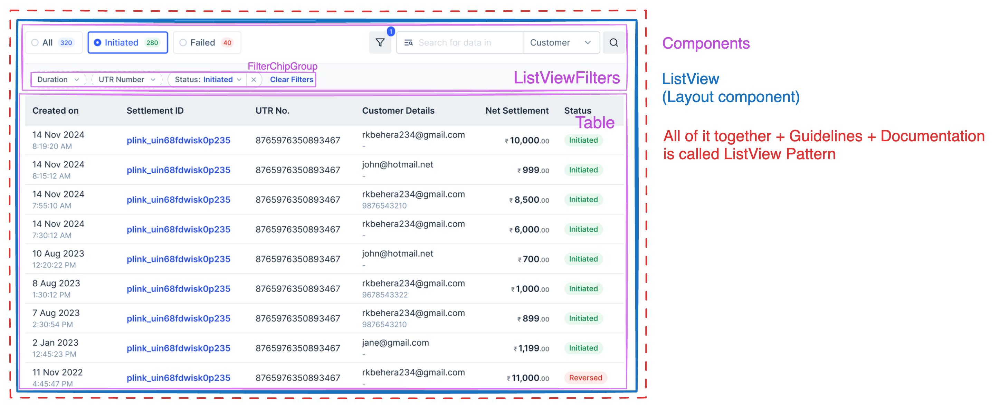
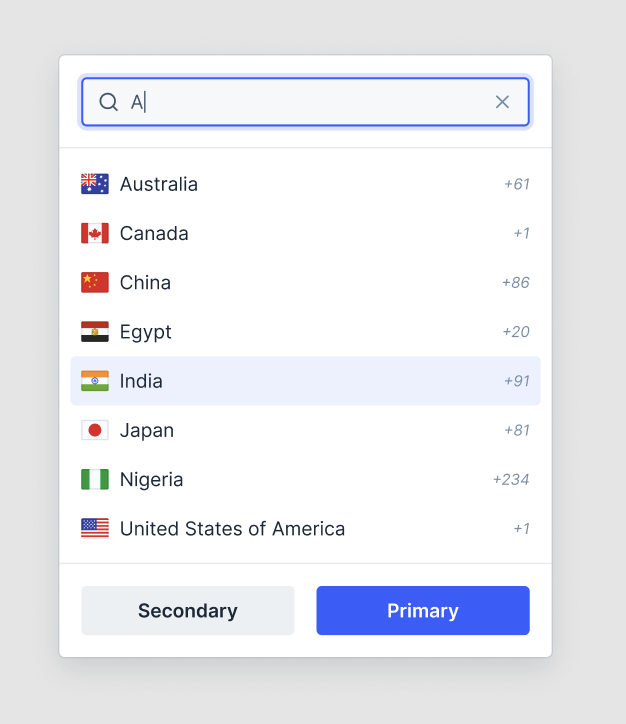
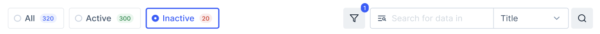

# List View Pattern API Decision

> [!NOTE]
>
> Questions like what is pattern, why are we building these patterns, and scope of pattern are answered in [pattern-terminology.md](./pattern-terminology.md)

List View Pattern is a UI pattern that includes Table, Filters, and Search of the table. It is a commonly used pattern on Klear dashboards to visualize data and help consumers filter / search through that data.



## API

### With Layout Component

```jsx
<ListView>
  <ListViewFilters
    quickFilters={
      <QuickFilterGroup onChange={({ values }) => console.log(values)}>
        <QuickFilter title="Status: Completed" value="completed" />
        <QuickFilter title="Status: Pending" value="pending" />
      </QuickFilterGroup>
    }
    onSearchChange={() => {
      /* filter on search */
    }}
  >
    <FilterChipGroup>
      <Dropdown>
        <FilterChip />
        <DropdownOverlay></DropdownOverlay>
      </Dropdown>

      <Menu>
        <FilterChip />
        <MenuOverlay>
          <TextInput />
        </MenuOverlay>
      </Menu>
    </FilterChipGroup>
  </ListViewFilters>
  <Table data={{ nodes: filteredNodes }} />
</ListView>
```

**Pros:**

- Layout can be controlled on design-system end which means in future if we decide to change layout of the list view pattern, consumers will only have to upgrade version
- Responsive layout can also be defined on design-system layer which other people might miss
- Consistent layout across all pages
- Functionality such as hide / show filters, placement of search, etc comes out of the box
- Less verbose compared to API without layout component

**Cons:**

- Restrictive API in what can be rendered inside the filters section. E.g. Search cannot be removed / moved to other-side (unless we give it as an option)
- Needs learning one more API with props like `quickFilters`, `onSearch`, etc compared to API without layout component where you use existing components and do custom layouts with Box.

### Alternate APIs

<details>
<summary>View alternate APIs like - API Without Layout Component, Config-driven filters, etc</summary>

#### Without Layout Component

```jsx
<Box>
  <Box display="flex" justifyContent="space-between">
    <QuickFilterGroup>
      <QuickFilter title="All" onClick={() => {}} />
      <QuickFilter title="Pending" onClick={() => {}} />
    </QuickFilterGroup>
    <Box>
      <Button icon={FilterIcon} />
      <InputGroup>
        <SearchInput />
        <Dropdown>
          <SelectInput />
          <DropdownOverlay></DropdownOverlay>
        </Dropdown>
      </InputGroup>
      <Button icon={SearchIcon} />
    </Box>
  </Box>
  <Box>
    <FilterChipGroup>
      <Dropdown>
        <FilterChip />
        <DropdownOverlay></DropdownOverlay>
      </Dropdown>

      <Menu>
        <FilterChip />
        <MenuOverlay>
          <TextInput />
        </MenuOverlay>
      </Menu>
    </FilterChipGroup>
  </Box>
  <Table data={{ nodes: filteredNodes }} />
</Box>
```

**Pros**

- No new layout component so consumers can use existing Box and existing components to create custom layouts
- More flexible API so consumers can add / remove / change items inside of filters section if needed

**Cons**

- No control over layout from design-system so tomorrow if we decide to change position of SearchInput for all filters in Klear, it cannot be done without a migration on consumer-side.
- Can lead to inconsistent spacings / responsive behaviours across pages if consumers don't handle it correctly.
- More verbose API as it requires handling layout manually
-

#### Config-driven filters

```jsx
<ListView>
  <ListViewFilterGroup
    quickFilters={[
      {
        title: 'All',
        onClick: () => setFilteredTableData(tableDefaultData),
      },
      {
        title: 'Pending',
        onClick: () =>
          setFilteredTableData(
            tableDefaultData.filter((tableData) => tableData.status === 'Pending'),
          ),
      },
    ]}
    filters={[
      {
        label: 'Status',
        options: ['All', 'Pending', 'Completed'],
        trigger: 'select-input',
        onChange: ({ name, value }) => {
          // filter on select
        },
      },
      {
        label: 'Customer Email',
        trigger: 'text-input',
        type: 'email',
        onBlur: () => {
          // filter on email change
        },
      },
      {
        label: 'Date',
        trigger: 'date-range',
        onChange: ({ name, value }) => {
          // filter on date range
        },
      },
    ]}
    onSearch={(searchValue, searchColumn = 'name') => {
      setFilteredTableData(
        tableDefaultData.filter((tableData) => searchValue.includes(tableData[searchColumn])),
      );
    }}
  />

  <Table data={{ nodes: filteredTableData }} />
</ListView>
```

**Pros**

- Less verbose compared to using dropdown and menu inside ListViewFilters

**Cons**

- Very strict API which might cause missing edge cases and rework on klear360-side for every product change
- Will have bundle of Dropdown, Menu, DatePicker, BottomSheet, etc even if that particular filter is not used
- Less intuitive because it'll introduce new config. Compared to previous API where consumers will use filters using the components that they already know how to use like Dropdown, Menu, etc.

#### Extension of Table component

In this case, we add quickfilters, filters, search as an option to our existing Table component

Similar to [react-data-grid](https://mui.com/x/react-data-grid/filtering/quick-filter/) by MUI

```jsx
<Table
  data={{ nodes }}
  hasSearch
  quickFilters={[
    { title: 'All', onClick: (nodes) => nodes },
    {
      title: 'Pending',
      onClick: (nodes) => nodes.filter((node) => node.status === 'Pending'),
    },
  ]}
  filters={[
    {
      label: 'Status',
      options: ['All', 'Pending', 'Completed'],
      trigger: 'select-input',
      onChange: ({ name, value }) => {
        // filter on select
      },
    },
    {
      label: 'Customer Email',
      trigger: 'text-input',
      type: 'email',
      onBlur: () => {
        // filter on email change
      },
    },
    {
      label: 'Date',
      trigger: 'date-range',
      onChange: ({ name, value }) => {
        // filter on date range
      },
    },
  ]}
/>
```

**Pros**

- Less verbose API
- Consistent filtering experience on all tables

**Cons**

- Too strict with very little flexibility
- Adds up more things in tables which can make table difficult to maintain and will contain bundle of filters even when they are not used

</details>

## Enhancements / Components

- Enhancements:
  - Searchable Dropdown
  - InputGroup (Deprioritised for later)
- New Components
  - ListView (Layout Component)
  - FilterChip
  - QuickFilter

### Dropdown with AutoComplete in Overlay



```jsx
<Dropdown>
  <SelectInput />
  <DropdownOverlay>
    <DropdownHeader>
      <AutoComplete />
    </DropdownHeader>
    <ActionList>
      <ActionListItem />
      <ActionListItem />
      <ActionListItem />
    </ActionList>
</Dropdown>
```

### FilterChipGroup


#### Usage

```jsx
const [duration, setDuration] = React.useState();
const [utrNumber, setUtrNumber] = React.useState();
const utrNumberInputValueRef = React.useRef(null);

<FilterChipGroup>
  <FilterChipDatePicker
    label="Duration"
    selectionType="range"
    onChange={(date) => setDuration(date)}
  />

  {/* FilterChip as trigger for Menu will be released in future and not as part of initial development */}
  <Menu>
    <FilterChip value={utrNumber} onClearButtonClick={({ value }) => setUtrNumber(undefined)}>
      UTR Number
    </FilterChip>
    <MenuOverlay>
      <TextInput ref={utrNumberInputValueRef} />
      <Button onClick={() => setUtrNumber(utrNumberInputValueRef.current.value)}>Submit</Button>
    </MenuOverlay>
  </Menu>

  <Dropdown>
    <FilterChipSelectInput
      value={status}
      defaultValue="Initiated"
      onClearButtonClick={({ value }) => setStatus(undefined)}
      label="Status"
    />
    <DropdownOverlay>
      <ActionList>
        <ActionListItem title="All" onClick={({ name, value }) => setStatus(name)} />
        <ActionListItem title="Pending" onClick={({ name, value }) => setStatus(name)} />
        <ActionListItem title="Completed" onClick={({ name, value }) => setStatus(name)} />
      </ActionList>
    </DropdownOverlay>
  </Dropdown>
</FilterChipGroup>;
```

#### Props

##### FilterChipGroup

```ts
type FilterChipGroupProps = {
  /**
   * Children prop. Supports Dropdown, Menu components
   *
   */
  children: React.ReactNode;
};
```

##### FilterChip

FilterChip can be used as a trigger for Dropdown and Menu

```ts
type FilterChipProps = {
  /**
   * Controlled value of FilterChip.
   *
   * FilterChip is always a controlled component since selected state of it comes from other components like Menu, Dropdown.
   */
  value: string;

  /**
   * Change handler when FilterChip's value is cleared
   */
  onClearButtonClick: ({ value }: { value: string }) => void;

  /**
   * Children. Title of the Chip
   */
  children: string;

  /**
   * Disabled state for Chip
   */
  isDisabled?: boolean;
};
```

### ListView (Layout Component)

Layout Component for handling the overall layout of ListView and Filters. More about layout components at [pattern-terminology.md](./pattern-terminology.md)

```jsx
<ListView>
  <ListViewFilters
    quickFilters={
      <QuickFilterGroup onChange={({ values }) => console.log(values)}>
        <QuickFilter title="Status: Completed" value="completed" />
        <QuickFilter title="Status: Pending" value="pending" />
      </QuickFilterGroup>
    }
    onSearch={({ value, searchType }) => {
      /* filter on search */
    }}
  >
    <FilterChipGroup></FilterChipGroup>
  </ListViewFilters>
  <Table />
</ListView>
```

#### Props

##### ListView

```ts
type ListViewProps = {
  children: React.ReactNode;
};
```

##### ListViewFilters



```ts
type QuickFilter = {
  title: string;
  onClick: (e: React.MouseEvent) => void;
};

type OnSearchArgs = {
  /**
   * Value of the search input field
   */
  value: string;

  /**
   * Value of the Dropdown next to search input
   */
  searchType: string;
};

type ListViewFiltersProps = {
  /**
   * Slot for QuickFilterGroup
   */
  quickFilters: React.ReactElement;

  /**
   * Callback when user clicks search button
   *
   * This prop also controls whether search should be shown or not. When this is undefined, search is removed from layout
   */
  onSearch?: ({ value, searchType }: OnSearchArgs) => void;
};
```

### QuickFilterGroup

```jsx
<QuickFilterGroup onChange={({ values }) => console.log(values)}>
  <QuickFilter title="Status: Completed" value="completed" />
  <QuickFilter title="Status: Pending" value="pending" />
</QuickFilterGroup>
```

#### Props

##### QuickFilterGroup

```ts
export type QuickFilterGroupProps = {
  /**
   * Handler that returns selected values
   */
  onChange: ({ values }: { values: string[] }) => void;

  /**
   * Decides whether the filters are single select with radio or multiselect with checkboxes
   */
  selectionType?: 'single' | 'multiple';
};
```

##### QuickFilter

```ts
export type QuickFilterProps = {
  /**
   * Visible title
   */
  title: string;

  /**
   * Value that is returned in onChange callback of QuickFilterGroup
   */
  value: string;

  /**
   * Slot that comes after title. For Badge and Counter
   */
  titleSuffix: React.ReactElement;
};
```

## Accessibility

- All interactive items like Filters, Search, Button should be focussable
- Dropdown's keyboard navigation should continue to work the same way for FilterChip as it does for other triggers like Select

## Open Questions

- ### Naming `ListView` vs `TableFilterView`

  Currently we're calling it ListView because the terminology was used in Klear although this terminology is not really used anywhere outside of Klear and can cause confusion to new people who join.

  Alternate Options

  - ListView
  - FilterView
  - TableFilterView

  - **Conclusion:**
    - We decided to call it ListView due to its familiarity in Klear and confusion it can cause to existing developers and designers in klear

- ### Do we want to control layout or not?

  Currently proposed API assumes that we are controlling which item is placed where and thus proposes a Layout Component of ListView. I've mentioned the pros and cons of layout component. The API and alternate api is proposed above.

  #### Tradeoffs of Layout Component

  - If we go with Layout component, then the tradeoff is the educational effort of teaching consumer which part of the UI comes directly from klear360 as layout component.
  - If we go without Layout component, tradeoff is not being able to update the layout changes on consumer if something updates in dev.

  - **Conclusion:**
    - We decided to go ahead with layout components in this case because we see near-future usecases where we might have to move items / change visuals of internal components (e.g. going from 2 inputs to search to InputGroup component). Doing this without layout components would cause dev efforts on consumer-side everytime we decide to change the layout.
    - We discussed it against the tradeoff of introducing new components vs letting people use the existing components like SearchInput etc. Although technical limitations of not being able to ship layout changes takes more priority over the educational effort of teaching these new components.

- ### InputGroup

  Current designs have search input clubbed with the select input which is part of the scope of InputGroup component. Do we want to build InputGroup right now or leave that for later and go with intermediate UI?

  - **Conclusion:**
    - We will be building this later. Currently we'll ship it with 2 inputs instead.

## Performance at scale (N=100+ rows)

`ListView` itself renders no items - it's a chrome/filter-bar wrapper (`ListViewFilters` + a styled
surface) around whatever's passed as `children`, almost always a `<Table>`. It doesn't map over
data or know the dataset exists. That has a useful consequence for high-density lists: filters
(`FilterChipGroup`, search) are structural siblings of `Table`, not children of its scrollable
body, so they're already outside any scrollport/virtualization boundary `Table` introduces - no
extra isolation work is needed at the `ListView` layer itself for that part.

The isolation work that *does* matter is inside `Table` - see `Table/_decisions/decisions.md`'s
"Virtualization" section for the full re-render architecture. The practical guidance for a
`ListView`-composed high-density list:

**Do:**
- Keep `ListViewFilters`'/`FilterChipGroup`'s own state (the filter VALUES) separate from
  anything that would force `Table`'s row-level context (`TableRowContext`) to recreate - route
  filter changes through `Table`'s own `globalFilterValue`/`columnFilterValues` controlled props
  (which live in `TableDataContext`, not `TableRowContext`), rather than, say, re-mounting `<Table
  key={filterValue}>` or passing a new `data` array reference on every filter keystroke before the
  filter is actually meant to apply.
- Use `TableVirtualizedWrapper` once a `Table` inside `ListView` is expected to render on the order
  of 50-100+ rows per page with several custom cells each (e.g. KlearNow Track & Trace's ~15-18
  column invoice grid) - this is the only thing that bounds the *mounted* row count, independent of
  the context-split work.
- Give the `Table` an explicit height (e.g. `height="500px"`) when virtualizing - `TableVirtualizedWrapper`
  needs a sized viewport to measure against (see `Table`'s decisions doc).

**Don't:**
- Don't key `Table` (or anything wrapping it) by the current filter/search value to "force a
  refresh" - that remounts the whole virtualized list (losing scroll position and re-mounting every
  row) for a scenario the context split already handles without remounting anything.
- Don't compute per-row visual density (row height, padding) as a function of the *total* filtered
  count if it's meant to vary continuously - `Table`'s `rowDensity` is a fixed compact/normal/comfortable
  choice per instance, and `TableVirtualizedWrapper`'s `rowHeight` callback currently has a
  confirmed off-by-one for genuinely variable (non-constant) heights (see `Table`'s decisions doc,
  "Known gaps") - don't rely on it for anything beyond a uniform height until that's fixed.
- Don't assume a sticky/frozen leading column "just works" under virtualization without checking
  viewport width - `Table` disables sticky columns below its mobile breakpoint regardless of
  virtualization, which can look like a virtualization bug in a narrow preview/embed when it's
  actually the existing, intentional mobile fallback.

## Card list virtualization (composition pattern, not a new component)

KlearNow's "Card & map" view (a vertical list of `Card`s next to a Leaflet map, as an alternative to
the `Table` view inside the same `ListView`) has no dedicated Klear360 component today -
`ListView` only composes `ListViewFilters` + whatever single child is passed, and that child has
always been `Table` in every example in this file. There is no `VirtualizedCardList` or equivalent
in this package.

Rather than build one speculatively, the guidance for a consumer who needs to virtualize a Card
list inside `ListView` is a **composition contract**, mirroring the same shape `Table` already
uses:

1. **Filters/search stay structural siblings of the virtualized list**, exactly as `ListViewFilters`
   already sits outside `Table`'s own body today - don't put filter chips/search *inside* whatever
   virtualizes the Card list, for the same reason `Table`'s filter row survives virtualization: it
   needs to stay outside the scrollport's render cycle.
2. **Filter/search state changes should not remount the virtualized list.** If a consumer wires a
   third-party windowing library (e.g. `react-window`'s own `VariableSizeList`, which
   `TableVirtualizedWrapper` itself wraps) directly around a `Card` list, the filtered `items` array
   passed to it should change by reference only when the actual result set changes - not on every
   keystroke before a debounced/applied filter commits, and not via a changing `key` prop on the
   list itself.
3. **Selection state (if the Card list supports multi-select, mirroring `Table`'s `selectionType`)
   should live outside whatever context recreates on filter/search changes** - the same two-context
   split `Table` uses (`TableRowContext` vs `TableDataContext`) is the right model to reuse: one
   context for per-card selection/appearance state, a separate one for filter/sort/pagination state,
   so a search keystroke doesn't re-render every mounted card.
4. **This is explicitly a pattern to replicate, not a hook or component to import** - `useResize`
   (`~utils/useResize`) is reusable as-is for measuring the available viewport/container size, but
   there is no shared "virtualized list" primitive below `TableVirtualizedWrapper` in this package
   today. A future `VirtualizedCardList` or similar would need its own proposal/decision doc, scoped
   separately from this one.

## References

- [Filtering - Carbon](https://carbondesignsystem.com/patterns/filtering/)
- [Data Grid - Material UI ](https://mui.com/x/react-data-grid/filtering-recipes/)
- [Filter Pattern - Dell Design System](https://www.delldesignsystem.com/patterns/filter/)
- References for Patterns in [pattern-terminology.md#references](./pattern-terminology.md#references)
